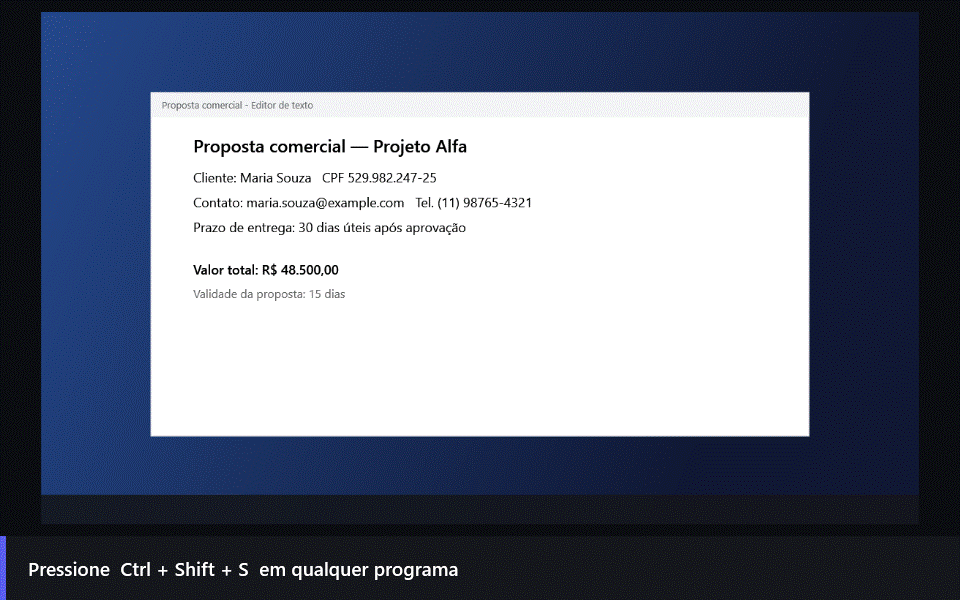
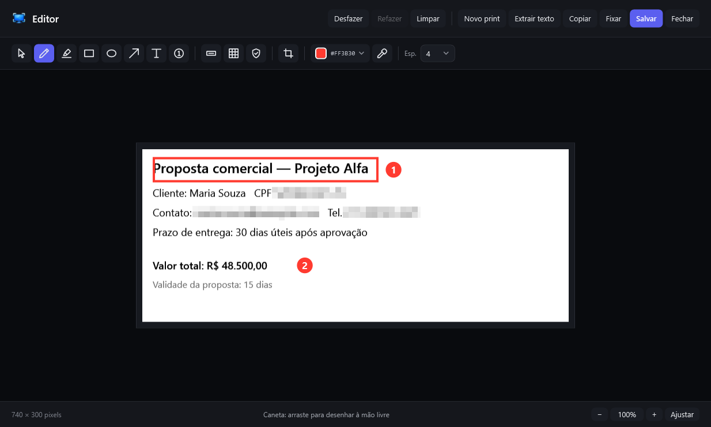
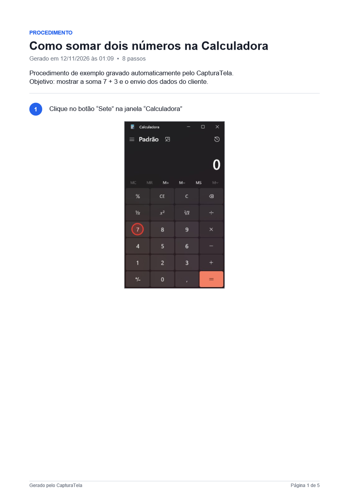
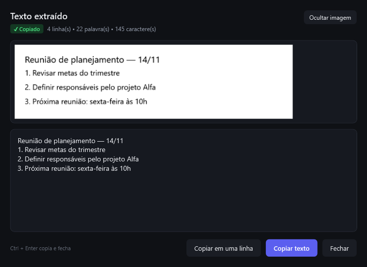



# CapturaTela

**Prints rápidos, anotações e dados sensíveis escondidos — em segundos.**

Capture qualquer parte da tela, marque o que importa, esconda CPF, e-mail e telefone,
copie o texto da imagem e **transforme uma tarefa num procedimento em PDF**.
Tudo no seu computador, sem internet.

Windows 10 (versão 2004 ou mais nova) e Windows 11 · 64 bits · não precisa de administrador

 
 

---

## ✨ O que ele faz por você

<table>
<tr>
<td width="50%" valign="top">

### ⚡ Print em um atalho
Aperte **`Ctrl + Shift + S`** em qualquer programa, arraste sobre o que quiser
e pronto: a imagem já está copiada para colar com `Ctrl + V`.

</td>
<td width="50%" valign="top">

### 🪟 Uma janela com um clique
Passe o mouse e a janela embaixo do cursor fica destacada.
Um clique captura **só ela**, com o recorte perfeito.

</td>
</tr>
<tr>
<td valign="top">

### 🔒 Esconda dados sensíveis
O botão **Mascarar dados** encontra **CPF, CNPJ, e-mail, telefone e cartão**
na imagem e aplica o mosaico sozinho. Ideal antes de enviar um print.

</td>
<td valign="top">

### 🔤 Copie o texto da imagem
Aperte **`Ctrl + Shift + X`**, selecione e o texto vai direto para a área
de transferência — e aparece numa janela para você conferir e corrigir.

</td>
</tr>
<tr>
<td valign="top">

### ✏️ Marque o que importa
Setas, retângulos, texto, marca-texto e **passos numerados (1, 2, 3…)**
para tutoriais. Desfazer e refazer para tudo.

</td>
<td valign="top">

### 📌 Mais que um print
**Fixe** a imagem por cima das outras janelas, **salve automaticamente**
numa pasta e reencontre suas capturas no **histórico**.

</td>
</tr>
<tr>
<td colspan="2" valign="top">

### 🧭 Novo: grave um passo a passo em PDF
Clique em **Gravar passos** e faça a tarefa normalmente: cada clique vira um passo com print
e descrição automática. Revise, esconda os dados sensíveis e **gere um PDF** pronto para enviar.

</td>
</tr>
</table>

  
   
  O editor: desenhe, destaque, esconda informações, recorte e copie.

---

## 🧭 Gravador de passos

Documentar um processo, explicar um erro para o suporte ou treinar alguém — sem montar prints na mão.

1. Clique em **Gravar passos** (na janela principal ou no ícone perto do relógio).
2. Faça a tarefa normalmente. **Cada clique vira um passo**, com o print da janela, o local do clique
   destacado e uma descrição automática, como *Clique no botão “Salvar” na janela “Bloco de Notas”*.
3. Clique em **Concluir** e revise: título, introdução, texto e observação de cada passo, ordem,
   imagens (dá para anotar no editor) e **Mascarar dados em todos** — CPF, CNPJ, e-mail, telefone e cartão.
4. Clique em **Gerar PDF**.

> 🔒 **O que você digita nunca é gravado.** O passo diz apenas “Digite o texto” (ou “Digite a senha”).
> A barra de gravação também não aparece nos prints.

  
   
  Primeira página de um procedimento gerado automaticamente

---

## ⬇️ Como instalar

1. Abra a **[página da versão mais recente](https://github.com/brunoedu9/capturatela-releases/releases/latest)**.
2. Em **Assets**, clique em **`CapturaTela-Setup-<versão>.exe`** para baixar.
3. Abra o arquivo baixado e siga o instalador (leva menos de um minuto).

Não é preciso instalar mais nada nem ter permissão de administrador.

> [!NOTE]
> **Apareceu "O Windows protegeu o computador"?**
> Isso acontece porque o instalador ainda não tem assinatura digital paga.
> Clique em **Mais informações** e depois em **Executar assim mesmo**.

---

## 🚀 Primeiros passos

1. Depois de instalado, o CapturaTela fica **no ícone perto do relógio** — mesmo com a janela fechada.
2. Aperte **`Ctrl + Shift + S`** e arraste sobre a área que quer capturar.
3. Na barra que aparece, escolha:
   - **Copiar** — e é só colar onde quiser
   - **Salvar** — PNG ou JPG
   - **Texto** — copia o texto da área
   - **Fixar** — deixa a imagem flutuando na tela
   - **Capturar** — abre o editor para anotar
4. Quer começar junto com o Windows? Ative em **Configurações → Iniciar com o Windows**.

---

## ⌨️ Atalhos mais úteis

| Atalho | O que faz |
|---|---|
| `Ctrl + Shift + S` | Capturar uma área (ou uma janela, com um clique) |
| `Ctrl + Shift + X` | Capturar só o texto |
| `Enter` ou duplo clique | Confirmar a seleção |
| `Esc` | Cancelar |
| `Ctrl + Z` / `Ctrl + Y` | Desfazer / refazer no editor |
| `Ctrl + C` / `Ctrl + S` | Copiar / salvar no editor |
| **Gravar passos** | Janela principal ou ícone perto do relógio |

<b>Ver todos os atalhos</b>

 

**Na seleção**

| Atalho | O que faz |
|---|---|
| `C` / `S` / `T` / `F` | Copiar / salvar / copiar texto / fixar |
| Setas | Mover a seleção 1 pixel |
| `Shift` + setas | Aumentar ou diminuir 1 pixel |
| `L` | Mostrar ou esconder a lupa |
| Botão direito | Desfazer a seleção |

**No editor**

| Atalho | Ferramenta |
|---|---|
| `V` | Selecionar (mover e apagar marcações) |
| `P` | Caneta |
| `H` | Marca-texto |
| `R` / `E` / `A` | Retângulo / elipse / seta |
| `T` | Texto |
| `N` | Passos numerados |
| `O` / `M` | Ocultar com tarja / mascarar com mosaico |
| `X` | Recortar |
| `I` | Conta-gotas |
| `Ctrl + T` | Fixar na tela |
| `Ctrl + roda do mouse` | Zoom |
| `Delete` | Apagar a marcação selecionada |

**Imagem fixada:** arraste para mover, roda do mouse para zoom, duplo clique ou `Esc` para fechar.

**Texto extraído:** `Ctrl + Enter` copia tudo e fecha.

---

## 🔤 Texto da imagem, do jeito certo

O texto reconhecido abre numa janela com:

- a **imagem de onde ele foi lido**, para conferir
- o **texto editável**, para corrigir antes de copiar
- **Copiar em uma linha**, que junta as linhas — ótimo para colar em formulários

Funciona offline, usando o reconhecimento de texto do próprio Windows,
no idioma configurado no seu computador.

  

---

## ❓ Perguntas frequentes

<b>Meus prints vão para algum lugar na internet?</b>

Não. Captura, edição e leitura de texto acontecem no seu computador.
A única conexão é a verificação de novas versões aqui no GitHub.

<b>O gravador de passos registra o que eu digito?</b>

Não. Ele registra cliques e teclas como Enter, Esc ou atalhos (Ctrl + S, por exemplo).
Quando você digita, o passo diz apenas “Digite o texto” — o conteúdo nunca é gravado.
Em campos de senha, o passo diz “Digite a senha”.

<b>Como atualizo para a versão nova?</b>

Não precisa fazer nada: o CapturaTela procura atualizações sozinho e avisa no ícone perto do relógio.
Clique em **Reiniciar e atualizar**. Se preferir, verifique em **Configurações → Atualizações**.

<b>O mosaico pode ser desfeito por quem recebe a imagem?</b>

Não. Na imagem copiada ou salva, os pixels originais são substituídos pelo mosaico.
Para dados sensíveis, use o nível **Médio** ou mais forte — e confira o resultado do *Mascarar dados*,
porque textos muito pequenos ou estilizados podem não ser reconhecidos.

<b>Fechei a janela. O CapturaTela parou?</b>

Não — ele continua no ícone perto do relógio, pronto para o `Ctrl + Shift + S`.
Para encerrar de vez, clique com o botão direito no ícone e escolha **Sair**.

<b>O atalho Ctrl + Shift + S não funciona.</b>

Outro programa pode estar usando a mesma combinação. Veja o aviso em **Configurações → Atalhos**.
Enquanto isso, use o botão **Selecionar área** ou o menu do ícone perto do relógio.

<b>Onde ficam o histórico e as configurações?</b>

Em `%LOCALAPPDATA%\CapturaTela`. O histórico guarda as últimas 30 capturas e pode ser
desligado ou apagado em **Configurações** e na aba **Histórico**.

<b>A atualização avisou que foi bloqueada.</b>

No Windows 11, o *Controle Inteligente de Aplicativos* pode bloquear instaladores sem assinatura digital.
Baixe a versão mais recente nesta página e instale manualmente.

<b>Como desinstalo?</b>

**Configurações do Windows → Aplicativos → Aplicativos instalados → CapturaTela → Desinstalar.**

---

## 🆕 Novidades

Veja o que mudou em cada versão na **[página de versões](https://github.com/brunoedu9/capturatela-releases/releases)**.

## 💬 Encontrou um problema ou tem uma ideia?

Abra uma **[issue](https://github.com/brunoedu9/capturatela-releases/issues)** contando o que aconteceu
(se puder, inclua um print 😉).

 
Feito para Windows · Captura, edição e OCR 100% locais

